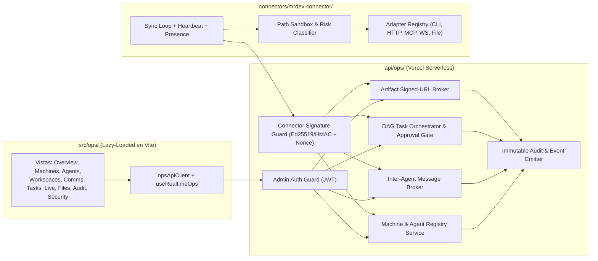
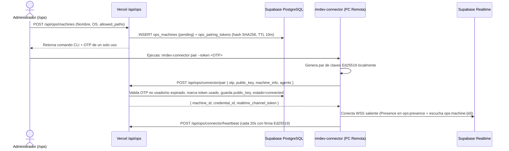
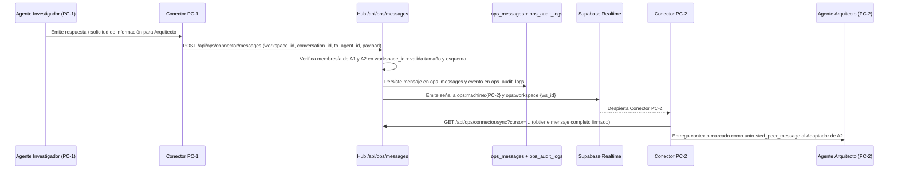
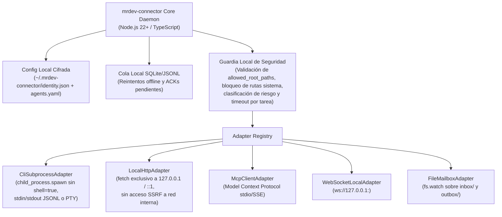

# Documento 3 — Arquitectura Técnica (`mrdev Ops Center`)

## 1. Visión General de la Arquitectura

La plataforma combina la interfaz React existente en Vercel (`https://mrdev.lat`), una capa API Serverless (`/api/ops/*`) dentro del mismo repositorio, PostgreSQL + Realtime + Storage en **Supabase**, y un conector ligero saliente (`mrdev-connector`) instalado en cada computador con agentes.

```mermaid
flowchart TB
    Admin["Administrador mrdev\n(Navegador Web / Móvil)"] -->|HTTPS + JWT Supabase Auth| VercelUI["Frontend Portafolio + /ops\n(Vite + React 19 en Vercel)"]
    VercelUI -->|HTTPS REST /api/ops/*| VercelAPI["Capa API & Orquestador\n(Vercel Serverless Functions)"]
    VercelUI <-->|WSS Subscripción Realtime| SupaRT["Supabase Realtime\n(Presence, Broadcast, DB Changes)"]

    VercelAPI -->|SQL Transaccional + RLS| SupaDB[("Supabase PostgreSQL\n(Tablas ops_*)")]
    VercelAPI -->|Emite Eventos| SupaRT
    VercelAPI -->|URLs Firmadas| SupaStore[("Supabase Storage\nBucket privado ops-artifacts")]

    subgraph M1 ["Máquina 1 (Ej. Windows Dev)"]
        C1["mrdev-connector\n(Daemon Saliente)"]
        A1["Agente CLI\n(CliSubprocessAdapter)"]
        A2["Agente MCP\n(McpClientAdapter)"]
        C1 <--> A1
        C1 <--> A2
    end

    subgraph M2 ["Máquina 2 (Ej. Linux VPS / Mac)"]
        C2["mrdev-connector\n(Daemon Saliente)"]
        A3["Agente HTTP Local\n(LocalHttpAdapter)"]
        A4["Agente Buzón/WS\n(FileMailbox / WS Adapter)"]
        C2 <--> A3
        C2 <--> A4
    end

    C1 -->|HTTPS Firmado Ed25519/HMAC| VercelAPI
    C1 <-->|WSS Saliente (Solo Lectura/Señal)| SupaRT
    C1 <-->|Upload/Download Firmado| SupaStore

    C2 -->|HTTPS Firmado Ed25519/HMAC| VercelAPI
    C2 <-->|WSS Saliente (Solo Lectura/Señal)| SupaRT
    C2 <-->|Upload/Download Firmado| SupaStore
```

---

## 2. Arquitectura de Componentes y Responsabilidades



### Límites estrictos entre componentes
1. **Frontend (`/ops`):** Nunca se comunica directamente con máquinas locales ni ejecuta lógica de autorización por sí solo; consume `/api/ops/*` con el JWT de administrador y escucha eventos de actualización en Supabase Realtime.
2. **Backend Serverless (`/api/ops/*`):** Única fuente de autoridad. Valida identidad, permisos de workspace, ciclos DAG, firmas de conectores y registra todo en `ops_audit_logs`.
3. **Conector Local (`mrdev-connector`):** Nunca abre puertos TCP entrantes en la máquina. Todo tráfico hacia la nube es **saliente (HTTPS + WSS)**. Verifica localmente listas blancas de directorios (`allowed_root_paths`) y solicita aprobación humana antes de acciones de alto impacto.

---

## 3. Flujo de Emparejamiento y Conexión de Máquinas



---

## 4. Flujo de Orquestación de Tareas DAG (Ejemplo Multi-Máquina)

```mermaid
sequenceDiagram
    actor Admin as Administrador
    participant API as Vercel /api/ops/tasks
    participant DB as PostgreSQL (DAG Engine)
    participant RT as Supabase Realtime
    participant C1 as Conector PC-1 (Investigador)
    participant C2 as Conector PC-2 (Arquitecto/Dev)

    Admin->>API: Crea Workflow: T1(Investigador) -> T2(Arquitecto) -> T3(Dev) [approval=true]
    API->>DB: Guarda ops_workflows, T1(queued), T2(pending_dependencies), T3(pending_dependencies)
    API->>RT: Broadcast "task.queued" a ops:machine:{PC-1}

    RT-->>C1: Notificación instantánea de T1
    C1->>API: POST /api/ops/connector/tasks/T1/claim (firma + idempotency_key)
    API->>DB: Lock atómico (FOR UPDATE SKIP LOCKED), T1 -> running
    C1->>C1: Ejecuta Agente Investigador via Adapter
    C1->>API: POST /api/ops/connector/tasks/T1/complete { summary, artifact_ids }
    API->>DB: T1 -> completed; evalúa dependencias; T2 cambia a queued
    API->>RT: Broadcast "task.queued" a ops:machine:{PC-2}

    RT-->>C2: Notificación instantánea de T2
    C2->>API: Claim T2 -> Ejecuta Arquitecto -> Complete T2
    API->>DB: T2 -> completed; T3 tiene requires_human_approval=true -> T3 pasa a waiting_approval
    API->>RT: Notifica al Admin en UI "Aprobación requerida para T3"

    Admin->>API: POST /api/ops/approvals/{id}/decision { decision: "approved" }
    API->>DB: T3 -> queued
    API->>RT: Despacha T3 al Conector PC-2
```

---

## 5. Flujo de Comunicación Multiagente Mediada por la Plataforma



---

## 6. Arquitectura Interna del Conector Local y Adaptadores



---

## 7. Estrategia de Persistencia y Tiempo Real (Resiliencia ante Caídas)

1. **Regla de Oro: Realtime es señalización, HTTP + PostgreSQL es la fuente de verdad.**
   - Si Supabase Realtime sufre un microcorte o el computador entra en suspensión, ningún mensaje ni tarea se pierde: al reconectar, el conector ejecuta `GET /api/ops/connector/sync?since_cursor=<last_seq>` y recupera en orden todo lo ocurrido mientras estuvo desconectado.
2. **Idempotencia en cada transición:**
   - Todo `claim`, `complete`, `fail` o `message` lleva un `idempotency_key` UUID almacenado con restricción única temporal para evitar ejecuciones duplicadas ante reintentos de red.
3. **Telemetría en vivo sin saturar la base de datos:**
   - Los fragmentos parciales de salida (*streaming logs* mientras un agente piensa o escribe código) viajan por **Supabase Realtime Broadcast** (efímero, sin escrituras SQL por cada token); al finalizar la tarea o cada 15 segundos de checkpoint, el conector persiste el resumen consolidado y el log completo en Supabase Storage como artefacto.
