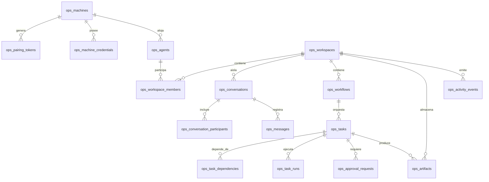

# Documento 4 — Modelo de Datos (`PostgreSQL / Supabase`)

## 1. Diagrama Entidad-Relación



---

## 2. Esquema SQL Completo (Listo para Migración en Supabase)

> **Convención:** Todas las tablas utilizan el prefijo `ops_` para aislarse limpiamente dentro de PostgreSQL y permitir verificación directa de RLS.

```sql
-- Extensiones requeridas
CREATE EXTENSION IF NOT EXISTS "pgcrypto";

-- =========================================================
-- 1. MÁQUINAS, EMPAREJAMIENTO Y CREDENCIALES
-- =========================================================
CREATE TABLE ops_machines (
  id UUID PRIMARY KEY DEFAULT gen_random_uuid(),
  custom_name TEXT NOT NULL,
  machine_fingerprint TEXT UNIQUE,
  os_type TEXT NOT NULL CHECK (os_type IN ('windows', 'macos', 'linux', 'unknown')),
  os_version TEXT,
  arch TEXT,
  status TEXT NOT NULL DEFAULT 'disconnected'
    CHECK (status IN ('connected', 'disconnected', 'busy', 'idle', 'error', 'reconnecting', 'revoked')),
  capabilities JSONB NOT NULL DEFAULT '[]'::jsonb,
  allowed_root_paths TEXT[] NOT NULL DEFAULT '{}',
  resource_snapshot JSONB NOT NULL DEFAULT '{}'::jsonb,
  last_error TEXT,
  last_heartbeat_at TIMESTAMPTZ,
  created_at TIMESTAMPTZ NOT NULL DEFAULT now(),
  updated_at TIMESTAMPTZ NOT NULL DEFAULT now()
);

CREATE TABLE ops_pairing_tokens (
  id UUID PRIMARY KEY DEFAULT gen_random_uuid(),
  machine_id UUID NOT NULL REFERENCES ops_machines(id) ON DELETE CASCADE,
  token_hash TEXT NOT NULL UNIQUE,
  expires_at TIMESTAMPTZ NOT NULL,
  used_at TIMESTAMPTZ,
  created_at TIMESTAMPTZ NOT NULL DEFAULT now()
);

CREATE TABLE ops_machine_credentials (
  id UUID PRIMARY KEY DEFAULT gen_random_uuid(),
  machine_id UUID NOT NULL REFERENCES ops_machines(id) ON DELETE CASCADE,
  public_key_ed25519 TEXT NOT NULL,
  key_fingerprint TEXT NOT NULL UNIQUE,
  is_active BOOLEAN NOT NULL DEFAULT true,
  rotated_from_id UUID REFERENCES ops_machine_credentials(id),
  revoked_at TIMESTAMPTZ,
  revoked_reason TEXT,
  created_at TIMESTAMPTZ NOT NULL DEFAULT now()
);

-- =========================================================
-- 2. AGENTES LOCALES
-- =========================================================
CREATE TABLE ops_agents (
  id UUID PRIMARY KEY DEFAULT gen_random_uuid(),
  machine_id UUID NOT NULL REFERENCES ops_machines(id) ON DELETE CASCADE,
  name TEXT NOT NULL,
  slug TEXT NOT NULL,
  specialty TEXT NOT NULL,
  description TEXT NOT NULL DEFAULT '',
  adapter_type TEXT NOT NULL
    CHECK (adapter_type IN ('cli-subprocess', 'local-http', 'mcp-client', 'local-ws', 'file-mailbox')),
  adapter_config JSONB NOT NULL DEFAULT '{}'::jsonb,
  tools JSONB NOT NULL DEFAULT '[]'::jsonb,
  capabilities JSONB NOT NULL DEFAULT '[]'::jsonb,
  status TEXT NOT NULL DEFAULT 'offline'
    CHECK (status IN ('online', 'busy', 'idle', 'offline', 'disabled', 'error', 'revoked')),
  is_enabled BOOLEAN NOT NULL DEFAULT true,
  max_concurrency INT NOT NULL DEFAULT 1 CHECK (max_concurrency BETWEEN 1 AND 10),
  created_at TIMESTAMPTZ NOT NULL DEFAULT now(),
  updated_at TIMESTAMPTZ NOT NULL DEFAULT now(),
  UNIQUE (machine_id, slug)
);

-- =========================================================
-- 3. ESPACIOS DE TRABAJO Y MEMBRESÍAS
-- =========================================================
CREATE TABLE ops_workspaces (
  id UUID PRIMARY KEY DEFAULT gen_random_uuid(),
  name TEXT NOT NULL,
  slug TEXT NOT NULL UNIQUE,
  domain_category TEXT NOT NULL DEFAULT 'software'
    CHECK (domain_category IN ('software', 'research', 'automation', 'marketing', 'data', 'operations', 'other')),
  description TEXT NOT NULL DEFAULT '',
  system_instructions TEXT NOT NULL DEFAULT '',
  shared_context TEXT NOT NULL DEFAULT '',
  participation_rules JSONB NOT NULL DEFAULT '{"require_human_approval_for_shell": true, "allow_inter_agent_comms": true}'::jsonb,
  is_archived BOOLEAN NOT NULL DEFAULT false,
  created_at TIMESTAMPTZ NOT NULL DEFAULT now(),
  updated_at TIMESTAMPTZ NOT NULL DEFAULT now()
);

CREATE TABLE ops_workspace_members (
  id UUID PRIMARY KEY DEFAULT gen_random_uuid(),
  workspace_id UUID NOT NULL REFERENCES ops_workspaces(id) ON DELETE CASCADE,
  agent_id UUID NOT NULL REFERENCES ops_agents(id) ON DELETE CASCADE,
  role TEXT NOT NULL DEFAULT 'contributor'
    CHECK (role IN ('contributor', 'reviewer', 'observer')),
  can_initiate_messages BOOLEAN NOT NULL DEFAULT true,
  can_upload_artifacts BOOLEAN NOT NULL DEFAULT true,
  added_at TIMESTAMPTZ NOT NULL DEFAULT now(),
  UNIQUE (workspace_id, agent_id)
);

-- =========================================================
-- 4. COMUNICACIONES MULTIAGENTE
-- =========================================================
CREATE TABLE ops_conversations (
  id UUID PRIMARY KEY DEFAULT gen_random_uuid(),
  workspace_id UUID NOT NULL REFERENCES ops_workspaces(id) ON DELETE CASCADE,
  title TEXT NOT NULL,
  kind TEXT NOT NULL CHECK (kind IN ('direct_human_agent', 'peer_agent_agent', 'group', 'broadcast')),
  created_by_type TEXT NOT NULL CHECK (created_by_type IN ('human', 'agent', 'system')),
  created_by_agent_id UUID REFERENCES ops_agents(id) ON DELETE SET NULL,
  created_at TIMESTAMPTZ NOT NULL DEFAULT now()
);

CREATE TABLE ops_conversation_participants (
  conversation_id UUID NOT NULL REFERENCES ops_conversations(id) ON DELETE CASCADE,
  agent_id UUID NOT NULL REFERENCES ops_agents(id) ON DELETE CASCADE,
  joined_at TIMESTAMPTZ NOT NULL DEFAULT now(),
  PRIMARY KEY (conversation_id, agent_id)
);

CREATE TABLE ops_messages (
  id UUID PRIMARY KEY DEFAULT gen_random_uuid(),
  seq BIGINT GENERATED ALWAYS AS IDENTITY,
  workspace_id UUID NOT NULL REFERENCES ops_workspaces(id) ON DELETE CASCADE,
  conversation_id UUID NOT NULL REFERENCES ops_conversations(id) ON DELETE CASCADE,
  sender_type TEXT NOT NULL CHECK (sender_type IN ('human', 'agent', 'system')),
  sender_agent_id UUID REFERENCES ops_agents(id) ON DELETE SET NULL,
  target_agent_id UUID REFERENCES ops_agents(id) ON DELETE SET NULL,
  message_type TEXT NOT NULL DEFAULT 'instruction'
    CHECK (message_type IN ('instruction', 'response', 'info_request', 'context_handoff', 'status_update', 'file_share', 'system_alert')),
  content TEXT NOT NULL,
  metadata JSONB NOT NULL DEFAULT '{}'::jsonb,
  artifact_ids UUID[] NOT NULL DEFAULT '{}',
  correlation_id UUID,
  idempotency_key TEXT UNIQUE,
  delivery_status TEXT NOT NULL DEFAULT 'persisted'
    CHECK (delivery_status IN ('persisted', 'dispatched', 'delivered', 'acknowledged', 'failed')),
  created_at TIMESTAMPTZ NOT NULL DEFAULT now()
);

-- =========================================================
-- 5. ORQUESTACIÓN DE TAREAS, DEPENDENCIAS Y APROBACIONES
-- =========================================================
CREATE TABLE ops_workflows (
  id UUID PRIMARY KEY DEFAULT gen_random_uuid(),
  workspace_id UUID NOT NULL REFERENCES ops_workspaces(id) ON DELETE CASCADE,
  title TEXT NOT NULL,
  goal TEXT NOT NULL DEFAULT '',
  status TEXT NOT NULL DEFAULT 'draft'
    CHECK (status IN ('draft', 'active', 'paused', 'completed', 'failed', 'cancelled')),
  created_at TIMESTAMPTZ NOT NULL DEFAULT now(),
  updated_at TIMESTAMPTZ NOT NULL DEFAULT now()
);

CREATE TABLE ops_tasks (
  id UUID PRIMARY KEY DEFAULT gen_random_uuid(),
  seq BIGINT GENERATED ALWAYS AS IDENTITY,
  workspace_id UUID NOT NULL REFERENCES ops_workspaces(id) ON DELETE CASCADE,
  workflow_id UUID REFERENCES ops_workflows(id) ON DELETE CASCADE,
  assigned_agent_id UUID NOT NULL REFERENCES ops_agents(id) ON DELETE RESTRICT,
  title TEXT NOT NULL,
  instructions TEXT NOT NULL,
  priority TEXT NOT NULL DEFAULT 'normal'
    CHECK (priority IN ('low', 'normal', 'high', 'urgent')),
  status TEXT NOT NULL DEFAULT 'draft'
    CHECK (status IN (
      'draft', 'pending_dependencies', 'queued', 'dispatched',
      'running', 'waiting_approval', 'paused', 'retrying',
      'completed', 'failed', 'cancelled'
    )),
  requires_human_approval BOOLEAN NOT NULL DEFAULT false,
  max_retries INT NOT NULL DEFAULT 1 CHECK (max_retries BETWEEN 0 AND 5),
  retry_count INT NOT NULL DEFAULT 0,
  timeout_seconds INT NOT NULL DEFAULT 600 CHECK (timeout_seconds BETWEEN 30 AND 14400),
  input_context JSONB NOT NULL DEFAULT '{}'::jsonb,
  output_summary TEXT,
  output_artifact_ids UUID[] NOT NULL DEFAULT '{}',
  error_message TEXT,
  started_at TIMESTAMPTZ,
  completed_at TIMESTAMPTZ,
  created_at TIMESTAMPTZ NOT NULL DEFAULT now(),
  updated_at TIMESTAMPTZ NOT NULL DEFAULT now()
);

CREATE TABLE ops_task_dependencies (
  task_id UUID NOT NULL REFERENCES ops_tasks(id) ON DELETE CASCADE,
  depends_on_task_id UUID NOT NULL REFERENCES ops_tasks(id) ON DELETE CASCADE,
  PRIMARY KEY (task_id, depends_on_task_id),
  CHECK (task_id <> depends_on_task_id)
);

CREATE TABLE ops_task_runs (
  id UUID PRIMARY KEY DEFAULT gen_random_uuid(),
  task_id UUID NOT NULL REFERENCES ops_tasks(id) ON DELETE CASCADE,
  machine_id UUID NOT NULL REFERENCES ops_machines(id) ON DELETE CASCADE,
  agent_id UUID NOT NULL REFERENCES ops_agents(id) ON DELETE CASCADE,
  attempt_number INT NOT NULL,
  status TEXT NOT NULL CHECK (status IN ('claimed', 'running', 'completed', 'failed', 'timed_out', 'cancelled')),
  idempotency_key TEXT NOT NULL UNIQUE,
  log_artifact_id UUID,
  started_at TIMESTAMPTZ NOT NULL DEFAULT now(),
  finished_at TIMESTAMPTZ
);

CREATE TABLE ops_approval_requests (
  id UUID PRIMARY KEY DEFAULT gen_random_uuid(),
  workspace_id UUID NOT NULL REFERENCES ops_workspaces(id) ON DELETE CASCADE,
  task_id UUID NOT NULL REFERENCES ops_tasks(id) ON DELETE CASCADE,
  machine_id UUID NOT NULL REFERENCES ops_machines(id) ON DELETE CASCADE,
  agent_id UUID NOT NULL REFERENCES ops_agents(id) ON DELETE CASCADE,
  risk_level TEXT NOT NULL CHECK (risk_level IN ('medium', 'high', 'critical')),
  action_type TEXT NOT NULL,
  action_summary TEXT NOT NULL,
  action_payload JSONB NOT NULL DEFAULT '{}'::jsonb,
  status TEXT NOT NULL DEFAULT 'pending'
    CHECK (status IN ('pending', 'approved', 'rejected', 'expired')),
  decision_note TEXT,
  decided_at TIMESTAMPTZ,
  created_at TIMESTAMPTZ NOT NULL DEFAULT now()
);

-- =========================================================
-- 6. ARTEFACTOS, ACTIVIDAD EN VIVO Y AUDITORÍA INMUTABLE
-- =========================================================
CREATE TABLE ops_artifacts (
  id UUID PRIMARY KEY DEFAULT gen_random_uuid(),
  workspace_id UUID NOT NULL REFERENCES ops_workspaces(id) ON DELETE CASCADE,
  task_id UUID REFERENCES ops_tasks(id) ON DELETE SET NULL,
  author_type TEXT NOT NULL CHECK (author_type IN ('human', 'agent', 'system')),
  author_agent_id UUID REFERENCES ops_agents(id) ON DELETE SET NULL,
  filename TEXT NOT NULL,
  mime_type TEXT NOT NULL,
  size_bytes BIGINT NOT NULL CHECK (size_bytes >= 0),
  sha256 TEXT NOT NULL,
  storage_path TEXT NOT NULL UNIQUE,
  origin_kind TEXT NOT NULL CHECK (origin_kind IN ('code', 'document', 'image', 'log', 'execution_result', 'other')),
  created_at TIMESTAMPTZ NOT NULL DEFAULT now()
);

CREATE TABLE ops_activity_events (
  id UUID PRIMARY KEY DEFAULT gen_random_uuid(),
  seq BIGINT GENERATED ALWAYS AS IDENTITY,
  workspace_id UUID REFERENCES ops_workspaces(id) ON DELETE CASCADE,
  machine_id UUID REFERENCES ops_machines(id) ON DELETE SET NULL,
  agent_id UUID REFERENCES ops_agents(id) ON DELETE SET NULL,
  task_id UUID REFERENCES ops_tasks(id) ON DELETE SET NULL,
  event_type TEXT NOT NULL,
  severity TEXT NOT NULL DEFAULT 'info' CHECK (severity IN ('info', 'warning', 'error', 'critical')),
  summary TEXT NOT NULL,
  payload JSONB NOT NULL DEFAULT '{}'::jsonb,
  created_at TIMESTAMPTZ NOT NULL DEFAULT now()
);

CREATE TABLE ops_audit_logs (
  id UUID PRIMARY KEY DEFAULT gen_random_uuid(),
  actor_type TEXT NOT NULL CHECK (actor_type IN ('admin', 'connector', 'agent', 'system')),
  actor_id TEXT NOT NULL,
  action TEXT NOT NULL,
  resource_type TEXT NOT NULL,
  resource_id TEXT NOT NULL,
  ip_address TEXT,
  details JSONB NOT NULL DEFAULT '{}'::jsonb,
  created_at TIMESTAMPTZ NOT NULL DEFAULT now()
);

CREATE TABLE ops_used_nonces (
  nonce TEXT PRIMARY KEY,
  machine_id UUID NOT NULL REFERENCES ops_machines(id) ON DELETE CASCADE,
  expires_at TIMESTAMPTZ NOT NULL
);
```

---

## 3. Índices de Alto Rendimiento

```sql
CREATE INDEX idx_ops_agents_machine ON ops_agents(machine_id, status);
CREATE INDEX idx_ops_ws_members_agent ON ops_workspace_members(agent_id, workspace_id);
CREATE INDEX idx_ops_messages_conv_seq ON ops_messages(conversation_id, seq DESC);
CREATE INDEX idx_ops_messages_target_seq ON ops_messages(target_agent_id, seq) WHERE delivery_status IN ('persisted', 'dispatched');
CREATE INDEX idx_ops_tasks_status_agent ON ops_tasks(assigned_agent_id, status, priority);
CREATE INDEX idx_ops_tasks_workflow ON ops_tasks(workflow_id, status);
CREATE INDEX idx_ops_approvals_pending ON ops_approval_requests(status, created_at DESC) WHERE status = 'pending';
CREATE INDEX idx_ops_artifacts_ws_task ON ops_artifacts(workspace_id, task_id, created_at DESC);
CREATE INDEX idx_ops_events_seq ON ops_activity_events(seq DESC);
CREATE INDEX idx_ops_events_ws_seq ON ops_activity_events(workspace_id, seq DESC);
CREATE INDEX idx_ops_nonces_exp ON ops_used_nonces(expires_at);
```

---

## 4. Políticas Row Level Security (RLS)

- **Principio:** El rol `anon` no tiene **ningún** acceso (`0` políticas para `anon`).
- Todas las mutaciones de conectores pasan por `/api/ops/connector/*` (usando `service_role` exclusivamente en servidor tras validar la firma Ed25519 de la máquina).
- El usuario autenticado en el frontend solo tiene acceso de lectura Realtime si su `auth.jwt() ->> 'email'` coincide con el propietario autorizado:

```sql
-- Aplicar a todas las tablas ops_*
ALTER TABLE ops_machines ENABLE ROW LEVEL SECURITY;
ALTER TABLE ops_pairing_tokens ENABLE ROW LEVEL SECURITY;
ALTER TABLE ops_machine_credentials ENABLE ROW LEVEL SECURITY;
ALTER TABLE ops_agents ENABLE ROW LEVEL SECURITY;
ALTER TABLE ops_workspaces ENABLE ROW LEVEL SECURITY;
ALTER TABLE ops_workspace_members ENABLE ROW LEVEL SECURITY;
ALTER TABLE ops_conversations ENABLE ROW LEVEL SECURITY;
ALTER TABLE ops_conversation_participants ENABLE ROW LEVEL SECURITY;
ALTER TABLE ops_messages ENABLE ROW LEVEL SECURITY;
ALTER TABLE ops_workflows ENABLE ROW LEVEL SECURITY;
ALTER TABLE ops_tasks ENABLE ROW LEVEL SECURITY;
ALTER TABLE ops_task_dependencies ENABLE ROW LEVEL SECURITY;
ALTER TABLE ops_task_runs ENABLE ROW LEVEL SECURITY;
ALTER TABLE ops_approval_requests ENABLE ROW LEVEL SECURITY;
ALTER TABLE ops_artifacts ENABLE ROW LEVEL SECURITY;
ALTER TABLE ops_activity_events ENABLE ROW LEVEL SECURITY;
ALTER TABLE ops_audit_logs ENABLE ROW LEVEL SECURITY;
ALTER TABLE ops_used_nonces ENABLE ROW LEVEL SECURITY;

-- Ejemplo de política de solo lectura para Realtime en UI del Administrador único
-- (Reemplazar '<OWNER_EMAIL>' o validar por claim personalizado app_metadata.ops_role = 'owner')
CREATE POLICY "ops_owner_read_machines" ON ops_machines
  FOR SELECT TO authenticated
  USING ((auth.jwt() -> 'app_metadata' ->> 'ops_role') = 'owner');

-- Repetir política SELECT para UI en: ops_agents, ops_workspaces, ops_conversations,
-- ops_messages, ops_workflows, ops_tasks, ops_approval_requests, ops_artifacts, ops_activity_events.
-- Tablas sensibles (ops_pairing_tokens, ops_machine_credentials, ops_used_nonces, ops_audit_logs):
-- CERO acceso desde cliente; exclusivamente vía Vercel Serverless Functions con service_role.
```
